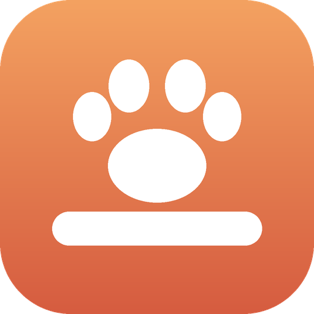

<p align="center">
  
</p>

# Haustier CB001 cat litter box for Home Assistant (Kedi Kumu)

Custom Home Assistant integration and Lovelace card for the **Haustier CB001** smart cat litter box (Tuya based). It recognizes **which cat** used the box from its weight, keeps a visit history per cat, tracks each cat's weight over time and shows everything on a dedicated dashboard card with cat profiles and photos.

> 🇹🇷 **Kısaca:** Haustier CB001 kum kabı için Home Assistant eklentisi ve kartı. Tuya entegrasyonunun attığı ham ziyaret kayıtlarını (DP 104) yakalar, her ziyaretin ağırlığını ve süresini çıkarır. İlk birkaç ziyarette "Bu kim?" diye sorup kedilerinizi ağırlıklarından tanımayı öğrenir. Kedi profilleri (isim, fotoğraf, renk), kilo grafikleri, ziyaret geçmişi ve telefona "kim kullandı?" bildirimleri içerir. Kartın arayüzü Türkçedir.

## Warning

This is an unofficial integration. It is not affiliated with, endorsed by, or supported by Haustier or Tuya.

Haustier CB001 does not expose its visit log through the official Tuya integration, so this integration attaches to the Tuya integration's message stream at runtime (see [How it works](#how-it-works)). It relies on internals of the `tuya-device-sharing-sdk` library and may stop working after a Home Assistant update. Use it at your own risk.

## Why

The official Tuya integration shows the CB001's `cat_weight` sensor, but it always stays `0`. The real data (cat entered with weight, time spent, cat left, cleaning finished) is sent on a raw data point, **DP 104**, which the Tuya integration drops because the product schema does not describe it. The Tuya app shows these records as its "log" screen.

This integration decodes those records and turns them into visits.

## Features

- **Visit tracking** from the raw Tuya records: weight, time in the box, start and end time, cleaning cycles.
- **Cat recognition by weight**
  - Add your cats with name, photo, color and an optional approximate weight.
  - During the first visits the card (and optionally your phone) asks **"Bu kim?"** ("Who was it?") with the most likely cat pre-selected.
  - After a configurable number of labels per cat (default 3), confident visits are assigned automatically.
  - Ambiguous visits (cats with similar weights, a weight between two cats) are always asked, never guessed.
  - You can correct any visit; the model updates immediately.
- **Robust weight model**
  - Each cat uses the median and MAD of its recent weights, so the model follows slow weight changes.
  - Once a cat is trained, a weight far from its model is stored but not learned, so a bad reading does not poison the model.
- **Scale drift warning**
  - The CB001 sometimes mistakes adding litter for a cat visit and then weighs wrong until it is power cycled.
  - When a weight matches no trained cat, `binary_sensor.kedi_kumu_tarti_supheli` turns on and the card shows a warning. Use it in an automation, for example to power cycle the box with a smart plug.
- **Actionable phone notifications** (iOS/Android companion app)
  - Each cat is a button, plus "Kedi değil" (not a cat).
  - Answering on one phone clears the question on the others.
- **Lovelace card** (`custom:kedi-kumu-card`), loaded automatically with no resource to add.
  - Live status, for example "Pamuk kumda · 3,78 kg".
  - Pending questions.
  - Cat tiles with photo, last weight, weight trend, sparkline and learning progress.
  - Today's timeline.
  - Recent visits and the full history with filters.
  - Per-cat detail with a 90-day weight chart and a 14-day visit chart.
  - Box controls: clean, light, auto clean.
  - Warnings when the waste bag is full, the drawer is out, or the scale looks wrong.
  - A `compact` mode for overview dashboards.
- **Box controls and hidden settings** (read and written over the LAN with the key the Tuya integration already has, Tuya protocol 3.5):
  - Level litter, UV sterilization, drum light, auto clean and clean delay.
  - Child lock, Do Not Disturb (time range), cleaning schedule, sterilization schedule.
  - Deodorizer days left.
  - All faults: waste bag full, drawer out, motor, weight sensor, filter. Each one sends a phone notification that clears itself when fixed.
- **Entities per cat**, so Home Assistant keeps long-term statistics:
  - Weight (kg).
  - Last visit.
  - Visits today.
- **Events** for automations: `kedi_kumu_visit` and `kedi_kumu_anomaly`.
- Local brand icons.

## Requirements

- Home Assistant **2026.11** or newer. This is the version it was developed and tested on.
- The official **Tuya** integration, set up with the account that owns the litter box (Smart Life / Tuya Smart app login).
- The litter box must be online in the Tuya cloud. The integration is cloud push and uses the same MQTT stream as the Tuya integration.

Tested device: **Haustier CB001**, Tuya category `msp`, product key `nietgqxmysgyf988`. Other Tuya litter boxes that send the same 9-byte record on DP 104 should work too. Please open an issue with your product key if you try one.

## Installation

### HACS (custom repository)

1. Open HACS in Home Assistant.
2. Open the three-dot menu and choose **Custom repositories**.
3. Add `https://github.com/brnskn/ha-haustier-cb001` with category **Integration**.
4. Install **Haustier CB001 (Kedi Kumu)**.
5. Restart Home Assistant.

### Manual

Copy `custom_components/kedi_kumu` into your Home Assistant config directory:

```text
<config>/custom_components/kedi_kumu
```

Then restart Home Assistant.

## Configuration

The integration's domain is `kedi_kumu` and it appears as **Kedi Kumu** in Home Assistant.


```text
Settings -> Devices & services -> Add integration -> Kedi Kumu
```

Litter boxes found in the Tuya integration (category `msp`) are listed. Pick yours and you're done.

**Options** (Configure on the integration):

| Option | Default | Description |
| --- | --- | --- |
| Phones to notify | none | `notify.mobile_app_*` services that receive "Who was it?" questions. |
| Labels needed per cat | 3 | Manual labels before a cat is recognized automatically. |

## The card

The card registers itself; no Lovelace resource is needed.

```yaml
type: custom:kedi-kumu-card
```

| Option | Default | Description |
| --- | --- | --- |
| `title` | `Kedi Kumu` | Card title. |
| `compact` | `false` | Only status, questions and cat tiles, plus a one-line summary. Good for an overview page. |
| `show_controls` | `true` | Show the clean, light and auto clean buttons. |
| `recent` | `6` | Number of recent visits shown. |

Cat photos are resized to 512×512 in the browser and stored under `<config>/kedi_kumu/photos/` with random file names.

## Entities

Box device (**Kedi Kumu**):

| Entity | Description |
| --- | --- |
| `sensor.kedi_kumu_durum` | Box state: `standby`, `cat_near`, `cat_in`, `cat_out`, `clean`, `sleep`, `uv`. Includes the states the Tuya integration filters out. |
| `sensor.kedi_kumu_son_kedi` | Name of the last cat. Attributes: weight, duration, time, status, confidence. |
| `sensor.kedi_kumu_bekleyen_etiket` | Number of visits waiting for a label. |
| `sensor.kedi_kumu_bugunku_ziyaret` | Visits today. |
| `sensor.kedi_kumu_son_temizlik` | Last finished cleaning cycle. |
| `sensor.kedi_kumu_koku_giderici` | Deodorizer days left (read over the LAN). Handy for a "replace soon" automation. |
| `binary_sensor.kedi_kumu_kedi_iceride` | A cat is in the box. Attributes: cat, weight. |
| `binary_sensor.kedi_kumu_tarti_supheli` | Scale suspect: a weight matched no cat. |

Each cat gets its own device. Entity ids are generated from the cat's name and the Home Assistant language; the names below are for Turkish:

| Entity | Description |
| --- | --- |
| `sensor.<cat>_kilo` | Last measured weight (kg, long-term statistics). Includes the cat photo as entity picture. |
| `sensor.<cat>_son_ziyaret` | Last visit time. |
| `sensor.<cat>_bugunku_ziyaret` | Visits today. |

## Services

| Service | Description |
| --- | --- |
| `kedi_kumu.add_visit` | Add a visit by hand (`weight_kg`, optional `start`, `duration`). |
| `kedi_kumu.reset_scale_warning` | Clear the scale suspect warning. |

## Events

`kedi_kumu_visit` is fired when a visit ends:

```yaml
visit_id: 3dfb49fffb
cat_id: 9a1c2e4f        # null when not recognized
cat_name: Pamuk
status: auto            # auto | manual | pending | not_cat
weight_kg: 3.78
duration: 42
start: "2026-11-17T16:21:51+00:00"
```

`kedi_kumu_anomaly` is fired when a weight matches no cat or is out of range.

### Example: power cycle after a wrong weight

```yaml
automation:
  - alias: Kum kabı tartısı kaydı
    triggers:
      - trigger: state
        entity_id: binary_sensor.kedi_kumu_tarti_supheli
        to: "on"
    conditions:
      - condition: state
        entity_id: binary_sensor.kedi_kumu_kedi_iceride
        state: "off"
    actions:
      - action: switch.turn_off
        target: { entity_id: switch.litter_box_plug }
      - delay: { seconds: 10 }
      - action: switch.turn_on
        target: { entity_id: switch.litter_box_plug }
      - action: kedi_kumu.reset_scale_warning
```

## How it works

The Tuya integration creates a `tuya_sharing.Manager` that receives device reports over MQTT and converts data points to codes using the product schema. Data points that are not in the schema are dropped.

Kedi Kumu wraps `Manager._on_device_report` on that manager instance. It copies the reports of the configured device to the Home Assistant event loop and then calls the original method, so the Tuya integration keeps working unchanged. The wrapper is re-attached every 30 seconds when the Tuya entry reloads, and removed when Kedi Kumu is unloaded.

### DP 104 record format

Base64 encoded, 9 bytes:

| Bytes | Meaning |
| --- | --- |
| 0–5 | Device local time: `YY MM DD hh mm ss` (year is 2000 + `YY`) |
| 6 | Record kind |
| 7–8 | Value, unsigned 16-bit big endian |

| Kind | Meaning | Value |
| --- | --- | --- |
| `0` | Cat near the box (presence sensor) | `0` |
| `3` | Cat entered | Weight in grams |
| `2` | Visit finished | Seconds spent in the box |
| `1` | Cat left | `0` |
| `5` | Cleaning cycle finished | `0` |

A real visit looks like this:

```text
19:21:40  dp24 cat_near   dp104 GgsRExUsAAAA  kind 0
19:21:51  dp24 cat_in     dp104 GgsRExU3Aw7E  kind 3, 0x0EC4 = 3780 g
19:22:33  dp7 1  dp8 42   dp104 GgsRExYlAgAq  kind 2, 42 s
19:22:33  dp24 cat_out    dp104 GgsRExYlAQAA  kind 1
19:23:03  dp24 clean      dp9 true
19:24:49  dp24 standby    dp104 GgsRExg1BQAA  kind 5
```

Other data points used: `dp24` box state, `dp7` visits today, `dp8` duration of the last visit.

### Data points outside the cloud schema

These were mapped by toggling each setting in the Tuya app and watching the device. Raw values are base64.

| DP | Setting | Value |
| --- | --- | --- |
| 1 | Manual UV sterilization | bool; runs until switched off (in the cloud schema as `switch`) |
| 102 | Level litter | bool trigger (state becomes `smooth`) |
| 103 | Child lock | bool |
| 105 | Do Not Disturb | raw `start_h start_m end_h end_m enabled` |
| 106 | Sterilization schedule | raw, 5 bytes per entry: `hour minute flags minutes enabled` |
| 107 | Cleaning schedule | raw, 3 bytes per entry: `hour minute enabled` |
| 109 | Deodorizer days left | int |
| 101, 108 | Not mapped yet (one is "add litter", which empties the drum) | bool |

DP 105–107 are only pushed when they change, so the integration stores their last value. The other data points are read over the LAN every 10 minutes and after each command.

### Recognition rules

For each cat: center = median of the last 15 learned weights, spread = max(MAD × 1.4826, 60 g). With fewer than 3 samples the spread is 150 g; with only the owner's estimate it is 250 g.

A visit is assigned automatically only when all of these hold:

- the nearest cat is trained (enough manual labels),
- every cat has a weight model,
- the weight is within 3 spreads and 450 g of that cat,
- it is at least 1.5 spreads and 120 g closer than the next cat.

Otherwise the visit is asked, with a suggestion.

Weights under 500 g or over 15 kg are marked "not a cat" automatically.

## Limitations

- Depends on the Tuya cloud and the internals of `tuya-device-sharing-sdk`.
- Visits that happen while Home Assistant is down are not recovered. Tuya's device log API is not used.
- Recognition uses weight only. Cats whose weights differ by less than ~150–200 g will often be asked instead of auto-assigned.
- The card UI is Turkish only. Entity and config flow texts are available in Turkish and English.
- Kind `0` (presence) is decoded but not used for visits.

## Development

Dependency-free unit tests (protocol decoding and recognition):

```bash
python3 -m unittest discover -s tests -v
```

Full integration check against a real Home Assistant install. It covers visit assembly from captured Tuya messages, learning, auto recognition, phone answers, the scale warning, photo upload and persistence. Run it inside the Home Assistant container:

```bash
docker cp . homeassistant:/tmp/ha-haustier-cb001
docker exec homeassistant sh -c "touch /tmp/ha-haustier-cb001/custom_components/__init__.py && python3 /tmp/ha-haustier-cb001/tests/ha_container_check.py /tmp/ha-haustier-cb001"
```

Quick checks:

```bash
python3 -m py_compile custom_components/kedi_kumu/*.py
node --check custom_components/kedi_kumu/frontend/kedi-kumu-card.js
```

## Roadmap

- Use visit time of day and duration as extra features for cats with similar weights.
- Read the Tuya device log to recover visits missed while Home Assistant was offline.
- English card UI.
- Diagnostics download.
- `pytest-homeassistant-custom-component` based tests.

## License

MIT
